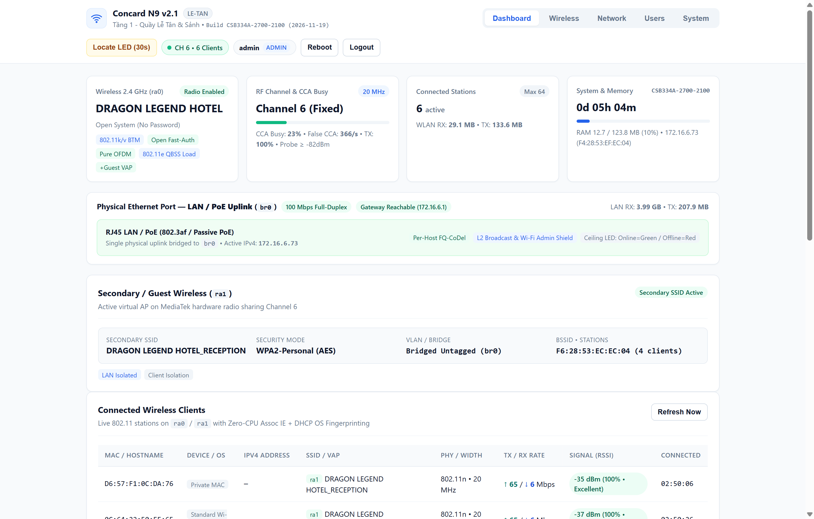
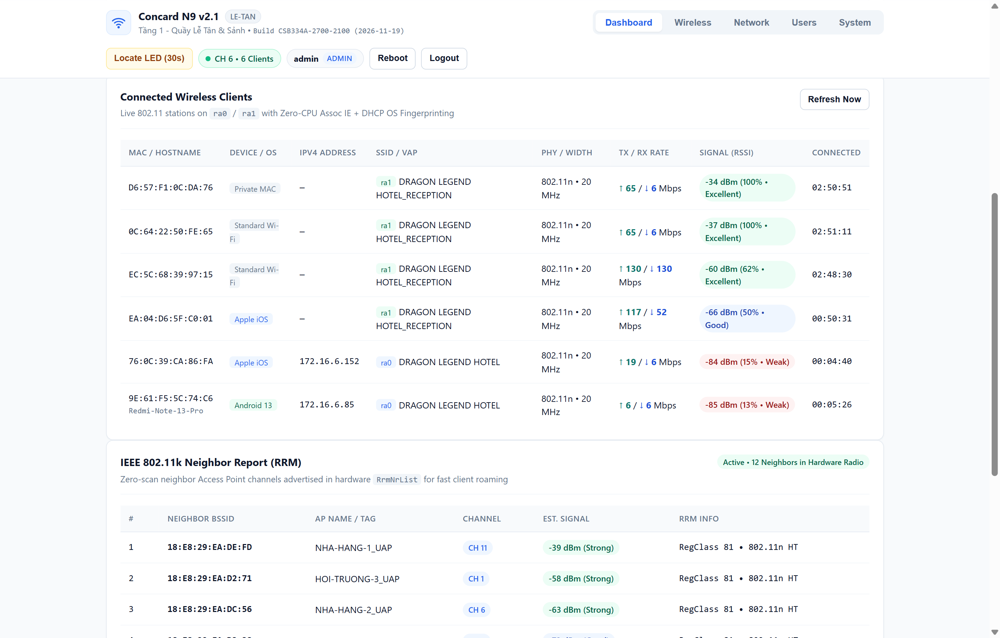
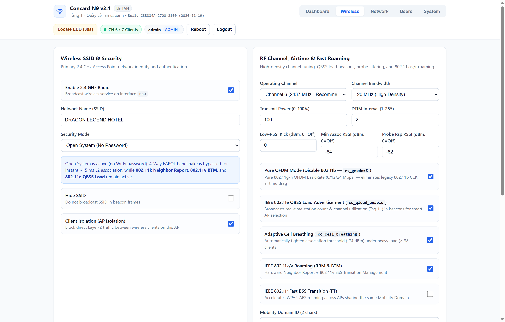
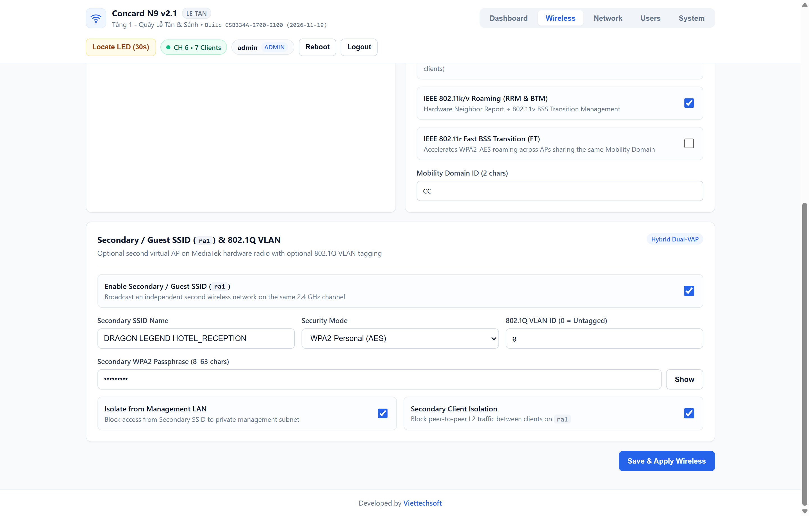
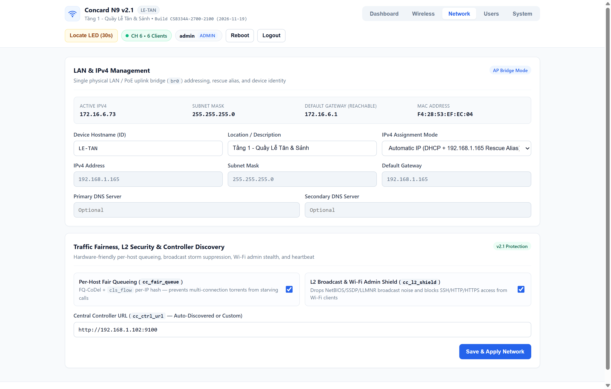
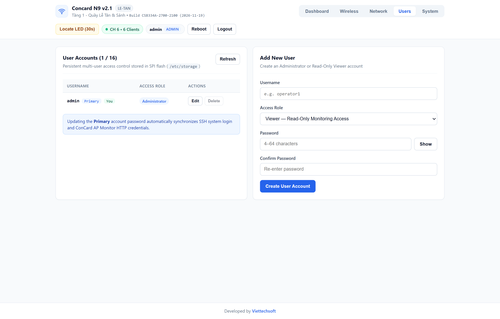
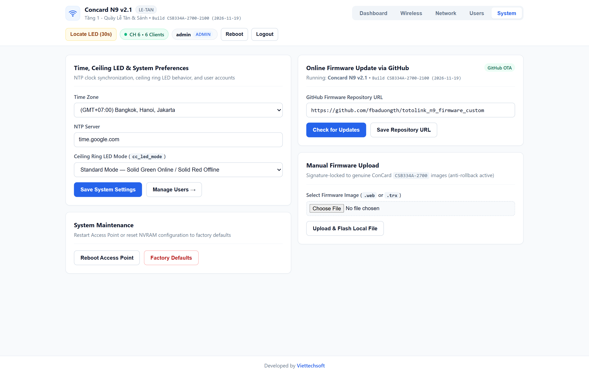

<div align="center">
  <h1>Concard N9 Enterprise Firmware v2.1</h1>
  <p><b>Custom High-Density Enterprise Access Point Firmware cho TOTOLINK N9 / N9v1 (<code>CSB334A</code> • Build <code>CSB334A-2700-2100</code>)</b></p>
  <p>Giao diện quản trị <b>Rust → WebAssembly (100% English UI)</b> • Nhận diện Hệ điều hành không tốn CPU (<b>BPF + 802.11 IE</b>) • Chuyển vùng thông minh <b>IEEE 802.11k/v + QBSS Load</b> • Công bằng băng thông <b>Per-Host FQ-CoDel</b> • Lá chắn Lớp 2 <b>L2 Security Shield</b> • Cập nhật trực tuyến <b>GitHub OTA</b></p>
  <p>
    
    
    
    
    
    
  </p>
</div>

---

## Mục Lục (Table of Contents)
1. [Tổng Quan & Động Lực Thiết Kế](#1-tổng-quan--động-lực-thiết-kế)
2. [Hình Ảnh Giao Diện Thực Tế (`Concard N9 v2.1`)](#2-hình-ảnh-giao-diện-thực-tế-concard-n9-v21)
3. [Thông Số Kỹ Thuật & So Sánh Phiên Bản](#3-thông-số-kỹ-thuật--so-sánh-phiên-bản)
4. [Chi Tiết Các Chức Năng Cốt Lõi Trên `v2.1`](#4-chi-tiết-các-chức-năng-cốt-lõi-trên-v21)
5. [Sơ Đồ Phân Vùng Flash & Tài Nguyên Hệ Thống](#5-sơ-đồ-phân-vùng-flash--tài-nguyên-hệ-thống)
6. [Hướng Dẫn Cài Đặt, Nâng Cấp & Rollback](#6-hướng-dẫn-cài-đặt-nâng-cấp--rollback)
7. [Hướng Dẫn Sử Dụng & Cấu Hình Chuẩn Khách Sạn](#7-hướng-dẫn-sử-dụng--cấu-hình-chuẩn-khách-sạn)
8. [Tài Liệu API, NVRAM & Công Cụ CLI Quản Trị](#8-tài-liệu-api-nvram--công-cụ-cli-quản-trị)
9. [Hướng Dẫn Tự Biên Dịch Từ Mã Nguồn](#9-hướng-dẫn-tự-biên-dịch-từ-mã-nguồn)

---

## 1. Tổng Quan & Động Lực Thiết Kế

**TOTOLINK N9 / N9v1** (bo mạch OEM **CaryStudio `CSB334A` Rev 0154**) sở hữu nền tảng phần cứng rất mạnh trong phân khúc Access Point ốp trần PoE `2.4 GHz`: vi xử lý **MediaTek MT7620A `580 MHz`**, **RAM `128 MB DDR2`** và bộ khuếch đại công suất rời **External PA + External LNA** (`2T2R 300 Mbps`). Tuy nhiên, firmware gốc của hãng (`V4.0c.2634`, nhân Linux `2.6.36` cũ) giới hạn cứng `32` client, thiếu hoàn toàn chuẩn chuyển vùng `802.11k/v/r`, không có cơ chế chống nghẽn hàng đợi và dễ treo khi chạy môi trường khách sạn đông thiết bị.

**`Concard N9 v2.1` (`Build CSB334A-2700-2100`)** là bản firmware chuyên dụng cấp doanh nghiệp/khách sạn được phát triển trên nhân **Linux `3.4.113`** cùng driver vô tuyến gốc **MediaTek `mt76x2_ap`**, tối ưu hóa chuyên sâu cho mô hình **70–100+ Access Point hoạt động đồng thời**:
- **Không cần tháo vỏ hàn UART / kẹp chip SPI:** Nạp trực tiếp file `.web` qua giao diện Web gốc của TOTOLINK, qua `sysupgrade` từ OpenWrt, hoặc cập nhật trực tuyến 1-Click từ GitHub (**Online OTA**).
- **Siêu nhẹ & bền bỉ 24/7:** Chỉ sử dụng **`~12.4 – 12.8 MB / 123.8 MB RAM`** (`~90%` RAM trống), CPU nghỉ **`99–100%`** ngay cả khi bật đầy đủ định danh OS, QoS công bằng theo từng máy và tường lửa Lớp 2.
- **Giao diện đơn giản hóa đúng phần cứng thực tế:** Thiết kế **100% tiếng Anh** viết bằng **Rust → WebAssembly (`ap_ui.wasm`)**, hiển thị đúng **1 cổng vật lý duy nhất `LAN / PoE Uplink (br0)`** của phần cứng N9 ốp trần kèm tốc độ cáp (`100M FD` / cảnh báo cáp lỗi `10M`).

---

## 2. Hình Ảnh Giao Diện Thực Tế (`Concard N9 v2.1`)

*(Ảnh chụp trực tiếp từ thiết bị vận hành thực tế `LE-TAN` — `http://172.16.6.73/` chạy `Concard N9 v2.1 Build CSB334A-2700-2100`)*

### 2.1. Dashboard — Tổng quan Sóng, Cổng vật lý đơn `LAN / PoE Uplink (br0)` & Mạng phụ `ra1`


### 2.2. Dashboard — Nhận diện Hệ điều hành Client (`Apple iOS`, `Android 13`, `Private MAC`) & Bảng láng giềng `802.11k` đa hãng


### 2.3. Wireless — Cấu hình sóng chính `2.4 GHz` & Bộ tối ưu RF mật độ cao (`Pure OFDM`, `QBSS Load`, `Cell Breathing`, `802.11k/v`)


### 2.4. Wireless — Phát đồng thời SSID phụ / nội bộ (`ra1`) & Cô lập `802.1Q VLAN`


### 2.5. Network — Cầu nối `AP Bridge` (DHCP + IP cứu hộ `192.168.1.165`), `Per-Host FQ-CoDel` & Lá chắn `L2 Shield`


### 2.6. Users — Phân quyền đa tài khoản quản trị (`Administrator` / `Viewer` Read-Only)


### 2.7. System — Chế độ đèn LED trần (`Standard` / `Night Mode`) & Cập nhật trực tuyến `GitHub OTA`


---

## 3. Thông Số Kỹ Thuật & So Sánh Phiên Bản

| Hạng mục kỹ thuật | Stock TOTOLINK `V4.0c.2634` | `Concard N9 v2.0` | **`Concard N9 v2.1` (`CSB334A-2700-2100`)** |
| :--- | :--- | :--- | :--- |
| **Nhân HĐH & Driver Wi-Fi** | Linux `2.6.36` • `rt2860v2` | Linux `3.4.113` • `mt76x2_ap` | **Linux `3.4.113` • `mt76x2_ap` (tối ưu IE & Probe)** |
| **Giao diện quản trị (`Web UI`)** | HTML/CGI cũ | Rust → WASM (Song ngữ, 5 cổng) | **Rust → WASM (`100% English`), chuẩn 1 cổng `PoE Uplink`** |
| **Số lượng Client tối đa / AP** | `32` clients | `64` clients | **`64` clients (`CONFIG_RT_MAX_CLIENTS=64`)** |
| **Mức chiếm dụng RAM / CPU** | ~24 MB RAM | ~12.2 MB RAM | **`~12.6 MB / 123.8 MB RAM` (~90% trống) • `< 1%` CPU** |
| **Chuyển vùng thông minh (`Roaming`)** | Không có | `802.11k/v/r` + Cell Breathing | **`802.11k/v/r` + `802.11e QBSS Load` + `Probe Rsp -82 dBm`** |
| **Nhận diện Thiết bị & Hệ điều hành** | Chỉ hiện MAC | OUI cơ bản | **Kernel `802.11 IE` + Classic BPF `DHCP Fingerprint` (`iOS`, `Android 11–16`, `macOS`, `Windows`) kể cả MAC ẩn danh** |
| **Quản lý hàng đợi QoS** | FIFO (dễ vọt ping) | `FQ-CoDel` theo cổng | **Per-Host `FQ-CoDel` + `cls_flow.ko` (chia luồng công bằng từng IP/MAC)** |
| **Bảo mật Lớp 2 (`L2 Security`)** | AP Isolation cơ bản | AP Isolation + Guest VLAN | **`CONCARD_L2_SHIELD`: Chặn Rogue DHCP, lọc bão Broadcast `SSDP/NetBIOS/LLMNR`, ẩn cổng quản trị trước khách Wi-Fi** |
| **Đèn LED trần thông minh & Định vị** | Chỉ báo nguồn | Nháy định vị 30s | **Báo sức khỏe L3 Gateway (Xanh = thông mạng, Cam = mất Gateway), Chế độ tắt đèn ban đêm (`Night Mode`) & Nháy định vị 30s** |
| **Cập nhật Firmware (`OTA`)** | Upload thủ công | Upload thủ công | **Dual-Path GitHub OTA (kiểm tra & nâng cấp trực tiếp từ GitHub hoặc qua trình duyệt trung gian)** |

---

## 4. Chi Tiết Các Chức Năng Cốt Lõi Trên `v2.1`

### 4.1. Nhận diện Hệ điều hành & Thiết bị thụ động Zero-CPU (`concard-dhcp-fp` + `802.11 IE`)
Trên các dòng điện thoại hiện đại (iOS 14+, Android 10+, Windows 11), tính năng **Private / Randomized Wi-Fi MAC** khiến bảng tra cứu mã nhà sản xuất OUI truyền thống mất tác dụng. `Concard N9 v2.1` giải quyết triệt để ngay tại AP mà không tốn CPU:
- **Ở tầng nhân Wi-Fi (`ap_assoc.c`):** Phân tích chữ ký các thẻ Information Elements trong gói `Association Request` (Apple OUI `00:17:F2`, Microsoft Epigram, Samsung/Android Vendor IE, HT Capabilities) ngay khoảnh khắc thiết bị bắt sóng.
- **Ở tầng mạng (`concard-dhcp-fp`):** Daemon viết bằng C thuần (`~10 KB`), gắn bộ lọc **12 lệnh Kernel Classic BPF (`SO_ATTACH_FILTER`)** ngay trong nhân Linux — 99.99% gói dữ liệu thường không bao giờ đánh thức tiến trình. Chỉ các gói `DHCP Request/Discover` (`UDP 67/68`) mới được giải mã `Option 55` (Parameter Request List), `Option 60` (Vendor Class) và `Option 12` (Hostname) để định danh chính xác `Apple iOS`, `Apple macOS`, `Android 11–16`, `Samsung`, `Windows PC`.

### 4.2. Tối ưu Sóng Mật Độ Cao & Chuyển Vùng Êm Ái (`802.11k/v` + `QBSS Load` + `Pure OFDM`)
- **Pure OFDM Mode (`rt_gmode=5`):** Loại bỏ hoàn toàn tốc độ cổ `802.11b` (`1 / 2 / 5.5 / 11 Mbps` CCK), ép khung quản trị/Beacon phát ở `6 / 12 / 24 Mbps` OFDM giúp giảm hơn **65% thời gian chiếm kênh (airtime)** của gói Beacon tại hành lang nhiều AP.
- **IEEE `802.11e` QBSS Load Advertisement (`cc_qload_enable=1`):** Nhúng thẻ `Tag 11` (số lượng client thực tế và tỷ lệ bận kênh CCA) vào mọi gói Beacon/Probe Response để điện thoại iPhone/Android chủ động chọn AP rảnh thay vì dồn cục vào 1 AP.
- **IEEE `802.11k` Neighbor Report & `802.11v` BTM (`rt_rrm_enable=1`):** Hỗ trợ nạp danh sách AP láng giềng đa hãng (kể cả AP UniFi / OpenWrt cùng hệ thống qua `/usr/sbin/concard-rrm-sync`) và gửi bản tin gợi ý chuyển vùng êm ái `BSS Transition Management` không làm rớt cuộc gọi Zalo/Teams.
- **Corridor Probe Request Filter (`cc_probe_rssi=-82`, `ApProbeRspTimes=2`):** Từ chối trả lời các gói dò sóng yếu `< -82 dBm` từ điện thoại khách đi lướt qua cuối hành lang xa, ngăn hiện tượng bám nhầm AP xa.
- **Adaptive Cell Breathing (`cc_cell_breathing=1`):** Khi lượng kết nối trên AP vượt ngưỡng tải cao (`>= 38 clients`), watchdog tự động thắt chặt ngưỡng nhận kết nối mới lên `-74 dBm` để san tải sang các AP kế cận.

### 4.3. Công Bằng Băng Thông Theo Từng Máy (`Per-Host FQ-CoDel`)
Khi bật `cc_fair_queue=1`, hệ thống nạp mô-đun nhân `sch_fq_codel.ko` kết hợp bộ phân loại luồng `cls_flow.ko` (`hash keys nfct-src / dst divisor 1024`) trên cả `ra0`, `ra1` và `eth2`:
- Chia băng thông công bằng theo **từng địa chỉ thiết bị khách (Per-Host)** thay vì gộp chung hàng đợi FIFO.
- Một phòng đang tải tệp dung lượng lớn hoặc xem video 4K **không làm tăng độ trễ ping** của các phòng khác dùng chung AP (`target 5ms`, `quantum 300`).

### 4.4. Lá Chắn Bảo Mật Lớp 2 (`CONCARD_L2_SHIELD`)
Khi bật `cc_l2_shield=1`, kịch bản `/usr/sbin/concard-vlan-apply` thiết lập các chuỗi lọc khung Ethernet ở tầng cầu nối `ebtables`:
1. **Rogue DHCP Guard:** Chặn tuyệt đối gói `UDP sport 67` phát ra từ giao diện Wi-Fi (`ra+`), ngăn chặn thiết bị khách hoặc bộ kích sóng cắm nhầm cấp phát IP giả làm sập mạng tòa nhà.
2. **Broadcast / Multicast Storm Suppression:** Lọc bỏ các gói quảng bá rác gây nghẽn sóng Wi-Fi (`NetBIOS UDP 137–138`, `SSDP UPnP UDP 1900`, `LLMNR UDP 5355`) trong khi giữ thông suốt `ARP`, `DHCP` và `ICMPv6`.
3. **Wireless Management Plane Stealth:** Chặn khách kết nối Wi-Fi truy cập vào các cổng quản trị của AP (`TCP 22 SSH`, `80 HTTP`, `443 HTTPS`, `7681 Web Terminal`) — chỉ cho phép quản trị viên truy cập từ mạng dây PoE Uplink (`eth2`), đồng thời tắt dịch vụ quảng bá `infosvr` (`UDP 9999`).

### 4.5. Đèn LED Trần Thông Minh, Chế Độ Ban Đêm & Định Vị Hàng Loạt
- **Normal Ceiling Status (`cc_led_mode=0`):**
  - **Đèn Xanh sáng tĩnh (`GPIO 11`):** Cáp PoE Uplink đạt chuẩn và thông suốt L3 tới Default Gateway.
  - **Đèn Cam sáng cảnh báo (`GPIO 39`):** Mất kết nối tới Gateway hoặc chưa nhận được IP mạng chính (đang bật IP cứu hộ dự phòng `192.168.1.165`).
- **Stealth / Night Mode (`cc_led_mode=1`):** Tắt hoàn toàn đèn xanh trên trần phòng ngủ khách sạn vào ban đêm để không gây chói mắt khách, nhưng vẫn tự động bật đèn cam nếu đứt mạng và vẫn nhận lệnh nháy đèn định vị khi bảo trì.
- **Locate LED (`30s`):** Chớp luân phiên Xanh – Cam tốc độ cao để kỹ thuật viên xác định ngay vị trí vật lý của AP trên trần hành lang.

### 4.6. Cập Nhật Trực Tuyến Qua GitHub (`Dual-Path GitHub OTA`)
Tích hợp sẵn tại tab **System → Online Firmware Update (GitHub OTA)** với kho mặc định `https://github.com/fbaduongth/totolink_n9_firmware_custom`:
- **Chế độ 1 (Direct AP OTA):** Nếu VLAN của AP có đường ra Internet, AP tự truy vấn `manifest.json` trên GitHub, đối chiếu phiên bản ngữ nghĩa, tải trực tiếp ảnh `.web`, kiểm tra chữ ký phần cứng `CSB334A-2700`, mã băm **SHA-256** và **uImage CRC32** trước khi ghi Flash.
- **Chế độ 2 (Browser-Relayed OTA — hỗ trợ VLAN quản trị cô lập không có Internet):** Nếu VLAN quản trị chặn AP ra Internet, trình duyệt của kỹ thuật viên sẽ tự động kiểm tra `manifest.json` trên GitHub, tải bản mới về bộ nhớ trình duyệt và đẩy thẳng xuống `/upgrade.cgi` của AP.

---

## 5. Sơ Đồ Phân Vùng Flash & Tài Nguyên Hệ Thống

### Bố cục chip nhớ `8 MB SPI NOR Flash` (`EN25QH64` / `W25Q64`)
```text
0x000000 ──┬────────────────────────────────────┬── mtd0: Bootloader (192 KB)   [U-Boot gốc - Giữ nguyên]
0x030000 ──┼────────────────────────────────────┼── mtd1: Config     (64 KB)    [NVRAM cấu hình]
0x040000 ──┼────────────────────────────────────┼── mtd2: Factory    (64 KB)    [MAC & Hiệu chuẩn RF PA/LNA]
0x050000 ──┼────────────────────────────────────┼── mtd3+mtd4: Firmware_Stub    (Tối đa 6,848 KB = 7,012,352 B)
           │  • Kernel 3.4.113 LZMA (~1.11 MiB) │   -> Ảnh Concard N9 v2.1: 5,664,179 bytes (5.40 MiB)
           │  • RootFS SquashFS XZ  (~4.29 MiB) │   -> Còn dư trống an toàn: 1,316 KB (~1.29 MiB)!
0x700000 ──┼────────────────────────────────────┼── mtd5: Storage    (1,024 KB) [/etc/storage bền vững qua nâng cấp]
0x800000 ──┴────────────────────────────────────┴── Kết thúc 8 MB SPI Flash
```

### Mã kiểm tra toàn vẹn bản phát hành `v2.1` (`Build CSB334A-2700-2100`)
- **File nạp chuẩn (`.web` & `.trx` đồng nhất uImage):** `releases/Concard_N9_CSB334A-2700_v2.1.web`
- **Dung lượng:** `5,664,179 bytes` (`5.40 MiB`)
- **SHA-256:** `de70a9efe7fdcba1c69be7637b1f3b90f8ca07047c02eed3cd2138aa536e2a90`

---

## 6. Hướng Dẫn Cài Đặt, Nâng Cấp & Rollback

### 6.1. Nạp lần đầu từ Firmware gốc TOTOLINK Stock (`V4.0c.2634`)
1. Tải file [`Concard_N9_CSB334A-2700_v2.1.web`](./releases/Concard_N9_CSB334A-2700_v2.1.web).
2. Cắm nguồn PoE ổn định cho AP và truy cập giao diện Web gốc của TOTOLINK (`http://192.168.1.165` hoặc IP hiện tại).
3. Vào mục **Management → Upgrade Firmware**, chọn file `Concard_N9_CSB334A-2700_v2.1.web` và bấm **Upgrade**.
4. Đợi khoảng **75–110 giây** để thiết bị xóa/ghi Flash và khởi động lại (tuyệt đối không rút cáp PoE trong lúc ghi).
5. Truy cập lại IP DHCP mới của AP (hoặc IP dự phòng `http://192.168.1.165` nếu cắm thẳng vào máy tính đặt IP tĩnh `192.168.1.10/24`) và đăng nhập mặc định:
   - **Username:** `admin`
   - **Password:** `admin`

### 6.2. Nâng cấp từ `Concard N9 v1.x / v2.0` lên `v2.1` (Giữ nguyên 100% cấu hình)
- **Cách 1 (Qua giao diện Web của AP):** Mở tab **System → Firmware Upgrade**, chọn file `Concard_N9_CSB334A-2700_v2.1.web` (hoặc bấm **Check for Updates** ở mục GitHub OTA) → nhấn **Upload & Flash**. Toàn bộ SSID, Channel, mật khẩu quản trị, tài khoản RBAC và danh sách láng giềng trong `/etc/storage` được giữ nguyên.
- **Cách 2 (Nạp cuốn chiếu hàng loạt 50–100 AP):** Sử dụng phần mềm quản lý tập trung **[ConCard AP Monitor](https://github.com/fbaduongth/Concard_N9v1)**, chọn `Concard_N9_CSB334A-2700_v2.1.web` với chế độ *Giữ nguyên SSID & Channel hiện tại + Tự động tối ưu*.

### 6.3. Chuyển đổi từ OpenWrt `23.05` sang `Concard N9 v2.1`
Chạy qua SSH trên thiết bị OpenWrt:
```sh
scp Concard_N9_CSB334A-2700_v2.1.web root@<IP_AP>:/tmp/fw.bin
ssh root@<IP_AP> "sysupgrade -F -n /tmp/fw.bin"
```

### 6.4. Rollback 1-Click về Firmware gốc hãng TOTOLINK (`V4.0c.2634`)
1. Vào tab **System → Manual Firmware Upload / Stock Rollback**.
2. Chọn file `.web` gốc của hãng TOTOLINK (`TOTOLINK_CSB334A_N9_..._V4.0c.2634_...web`) và nhấn **Upload**.
3. Firmware sẽ tự động nhận diện chữ ký Stock, làm sạch phân vùng `Config` NVRAM để tránh xung đột biến và đưa thiết bị về nguyên bản nhà sản xuất sau ~90 giây.

---

## 7. Hướng Dẫn Sử Dụng & Cấu Hình Chuẩn Khách Sạn

### 7.1. Thông số mặc định sau khi Khôi phục cài đặt gốc (Factory Reset `> 5s`)
- **Chế độ mạng:** Pure Access Point Bridge (`sw_mode=3`, cầu nối `br0`).
- **Nhận địa chỉ IP:** **DHCP Client** tự động; nếu sau 18 giây không thấy DHCP Server sẽ tự gắn thêm **IP quản trị cứu hộ `192.168.1.165/24`** (và tự gỡ IP phụ ngay khi mạng chính có DHCP trở lại).
- **Tài khoản Web UI & SSH:** `admin` / `admin` (khuyến nghị đổi ngay tại tab **Users**).

### 7.2. Bảng khuyến nghị cấu hình tối ưu cho Khách sạn / Tòa nhà nhiều tầng
| Tham số trên giao diện | Giá trị khuyến nghị | Giải thích kỹ thuật |
| :--- | :--- | :--- |
| **Operating Channel** | Cố định **`1`**, **`6`** hoặc **`11`** | Quy hoạch xen kẽ không chồng lấn theo sơ đồ tổ ong giữa các phòng và giữa các tầng liền kề |
| **Channel Bandwidth** | **`20 MHz (High-Density)`** | Tuyệt đối không dùng `40 MHz` trên băng tần `2.4 GHz` để tránh nhiễu kênh lân cận |
| **Pure OFDM Mode (`rt_gmode=5`)** | **Enabled (`Bật`)** | Tắt chuẩn cổ `802.11b`, giải phóng airtime cho `802.11g/n` |
| **IEEE 802.11e QBSS Load** | **Enabled (`Bật`)** | Quảng bá độ bận kênh để điện thoại tự cân bằng tải giữa các AP |
| **IEEE 802.11k/v Roaming** | **Enabled (`Bật`)** | Kích hoạt Neighbor Report & BSS Transition Management |
| **IEEE 802.11r Fast Roaming (FT)** | **`Tắt`** *(nếu sóng Open)* / **`Bật`** *(nếu WPA2 nội bộ)* | Sóng Open vốn không có bước bắt tay 4-Way EAPOL nên chuyển vùng sẵn `~15 ms`; tắt `802.11r` trên sóng khách giúp tương thích 100% mọi thiết bị đời cũ |
| **Low-RSSI Kick / Min Assoc / Probe Rsp** | `0` / **`-84 dBm`** / **`-82 dBm`** | Không ngắt cưỡng bức đột ngột, nhưng chặn bắt mới và lọc Probe từ khách ở quá xa hành lang |
| **Per-Host Fair Queueing (`FQ-CoDel`)** | **Enabled (`Bật`)** | Chống nghẽn Bufferbloat và chia đều băng thông giữa các thiết bị |
| **Layer-2 Security Shield** | **Enabled (`Bật`)** | Chặn DHCP giả mạo, lọc bão gói rác Multicast và bảo vệ cổng quản trị |

---

## 8. Tài Liệu API, NVRAM & Công Cụ CLI Quản Trị

### 8.1. Các Endpoint CGI tốc độ cao (phản hồi `~12 ms`, viết bằng C trong `httpd`)
- `GET /api_telemetry.cgi` — Trả về toàn bộ trạng thái hệ thống, cổng vật lý `100M FD`, độ bận sóng CCA, nhiệt độ, danh sách láng giềng RRM và bảng Client kèm nhãn `osHint` dưới dạng JSON chuẩn.
- `POST /api_locate.cgi` (`seconds=30` hoặc `seconds=0`) — Bật/tắt nháy đèn LED định vị thiết bị từ xa.
- `GET|POST /api_ota.cgi` (`action=check` / `action=upgrade`) — Kiểm tra phiên bản mới và kích hoạt nâng cấp OTA từ GitHub.
- `GET|POST /api_users.cgi` — Quản lý danh sách tài khoản phân quyền `admin` / `viewer`.

### 8.2. Các lệnh CLI hữu ích qua SSH (`admin@<IP_AP>`)
```sh
# Xem các biến cấu hình chuyên sâu của Concard N9 v2.1
nvram show | grep -E "^(rt_|cc_)"

# Kiểm tra hàng đợi công bằng Per-Host FQ-CoDel trên giao diện Wi-Fi
tc -s qdisc show dev ra0
tc filter show dev ra0

# Kiểm tra bộ đếm gói rác & Rogue DHCP bị chặn bởi L2 Security Shield
ebtables -t filter -L --Lc

# Đồng bộ lại danh sách láng giềng 802.11k vào driver mt76x2
/usr/sbin/concard-rrm-sync

# Kiểm tra bản cập nhật mới trên GitHub bằng dòng lệnh
/usr/sbin/concard-ota check
```

---

## 9. Hướng Dẫn Tự Biên Dịch Từ Mã Nguồn

### Cấu trúc thư mục mã nguồn
```text
totolink_n9_firmware_custom/
├── bsp/
│   ├── board.h / board.mk            # Định nghĩa phần cứng TOTOLINK N9v1 (GPIO 11/39/13, 128MB RAM, AP Role)
│   ├── concard_v2.c / concard_v2.h   # Engine C xử lý Telemetry JSON, OTA API, Locate LED & NVRAM v2.1
│   ├── concard_dhcp_fp.c             # Daemon C Classic BPF nhận diện Hệ điều hành qua DHCP Option 55/60/12
│   ├── concard_auth.c / .h           # Xác thực Session Cookie, HTTP Basic Auth & phân quyền RBAC SHA-256
│   ├── concard-vlan-apply            # Khởi tạo 802.1Q Guest VLAN, Per-Host FQ-CoDel & ebtables L2 Shield
│   ├── concard-watchdog              # Giám sát L3 Gateway LED, Fallback IP 192.168.1.165 & Cell Breathing
│   ├── concard-ota                   # Công cụ kiểm tra manifest.json & nạp trực tuyến từ GitHub
│   ├── CSB334A-2700.config           # Cấu hình gói Padavan tinh gọn
│   └── kernel-3.4.x.config           # Cấu hình nhân Linux 3.4.113 (Ext PA/LNA, 64 STA, FQ-CoDel, cls_flow, ebtables)
├── webui/
│   ├── Cargo.toml & src/lib.rs       # Mã nguồn giao diện quản trị viết bằng Rust biên dịch sang WebAssembly
│   ├── static/                       # Khung HTML/CSS/JS tối giản & cầu nối WASM
│   └── dist/ap_ui.wasm               # Gói nhị phân WebAssembly đã tối ưu dung lượng (~196 KB)
├── patches/                          # Bản vá nhân & driver MediaTek 802.11k/v/r + QBSS Load + IE Fingerprint
├── releases/
│   ├── Concard_N9_CSB334A-2700_v2.1.web  # Bản Firmware phát hành chính thức v2.1
│   ├── Concard_N9_CSB334A-2700_v2.1.trx  # Ảnh uImage đồng nhất
│   ├── manifest.json                     # Manifest phục vụ kiểm tra phiên bản OTA
│   └── SHA256SUMS.txt                    # Bảng đối chiếu mã băm SHA-256
├── apply_concard_n9v1_bsp.py         # Trình tự động áp dụng toàn bộ BSP & bản vá C/Kernel/WebUI vào cây rt-n56u
├── build_firmware.sh                 # Kịch bản biên dịch tự động trọn gói trên Ubuntu / WSL2
├── manifest.json                     # Manifest gốc cho GitHub Online OTA
└── LICENSE                           # Giấy phép nguồn mở GNU GPL-2.0
```

### Quy trình biên dịch trên Ubuntu 22.04/24.04 hoặc WSL2
```bash
# 1. Cài đặt gói phụ thuộc và Rust WASM target
sudo dpkg --add-architecture i386
sudo apt-get update && sudo apt-get install -y \
  git build-essential gawk pkg-config gettext automake autoconf autopoint \
  libtool-bin bison flex zlib1g-dev libgmp3-dev libmpfr-dev libmpc-dev \
  texinfo python3 kmod cmake gperf unzip curl wget
rustup target add wasm32-unknown-unknown

# 2. Tải cây nguồn nền rt-n56u & Toolchain mipsel-linux-uclibc
sudo git clone --depth=1 https://github.com/hanwckf/rt-n56u.git /opt/rt-n56u
cd /opt/rt-n56u/toolchain-mipsel && sudo ./dl_toolchain.sh

# 3. Biên dịch WebAssembly UI & đóng gói ảnh Firmware Concard N9 v2.1
cd /duong/dan/toi/totolink_n9_firmware_custom
cd webui && cargo build --target wasm32-unknown-unknown --release && cp target/wasm32-unknown-unknown/release/ap_ui.wasm dist/ap_ui.wasm && cd ..
chmod +x ./build_firmware.sh
sudo ./build_firmware.sh
```

---

## Liên Kết Hệ Sinh Thái & Giấy Phép
- **Hệ thống giám sát tập trung, nháy đèn hàng loạt & tối ưu sóng tự động:** [ConCard AP Monitor (`Concard_N9v1`)](https://github.com/fbaduongth/Concard_N9v1)
- **Giấy phép:** Phát hành theo giấy phép mã nguồn mở **[GNU General Public License v2.0 (GPL-2.0)](./LICENSE)**.
